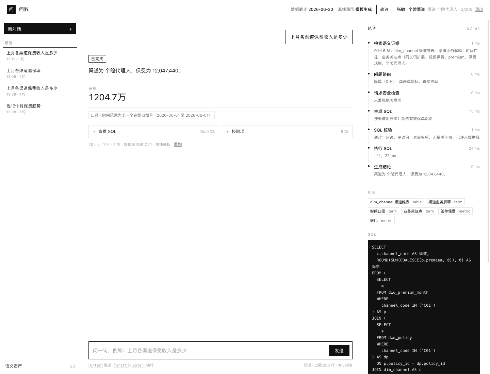
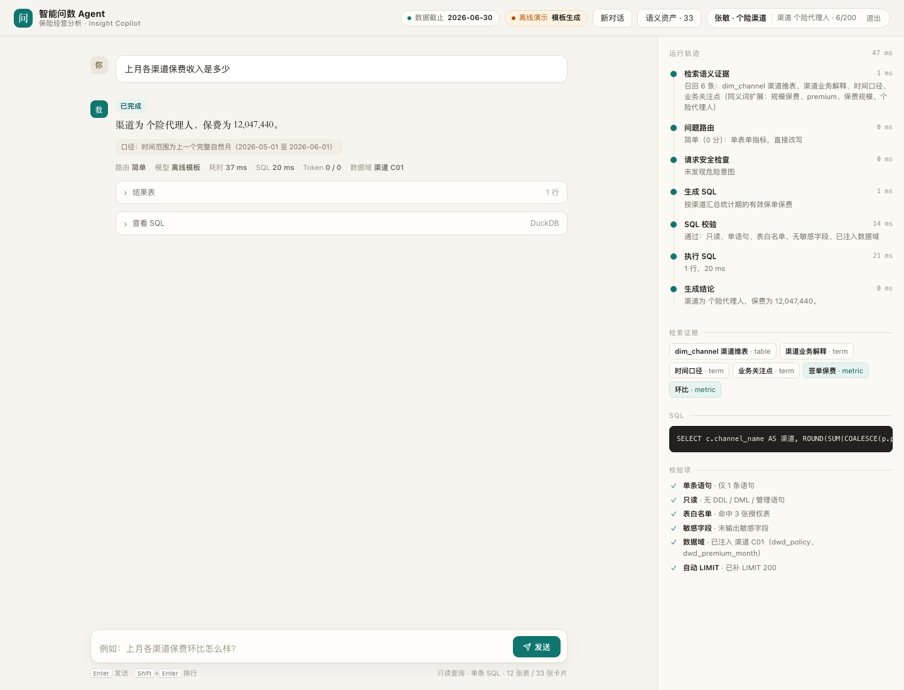

# 智能问数 Agent · 可运行版

把"自然语言 → SQL → 结论"做成一条**可复现、可评测、可审计**的链路：
语义层负责把业务黑话翻译成口径，Agent 负责检索与路由，Guard 负责拦住危险请求，评测集负责证明它到底行不行。

这不是又一个小 demo。它回答的是面试里最容易被追问的三件事：

1. **模型为什么这么写 SQL？** —— 检索到的指标卡、表卡、Join 卡都进了 Prompt，界面上能看到证据。
2. **写错了怎么办？** —— SQL 先过 AST 校验，失败带错误信息最小修复，最多两次。
3. **你怎么证明它好？** —— 164 道题、gold SQL 现场复算、分类准确率、消融开关，一条命令重跑。

现在它是一个**内部试点可用**的版本：登录、数据域、审计、多轮追问都做了，不再是"打开就是全量数据"的演示。

> 生产版（真实业务里做到 85%+、取数 6 小时 → 30 秒）的复盘在作品集案例页；
> 这里是**合成数据上的公开复现**，所有数字都可以自己跑出来，口径与边界写在 [评测说明](#评测怎么做) 里。

---



## 面试演示

3 分钟怎么讲、会被追问什么、哪些数字能说哪些不能说：[docs/interview-script.md](docs/interview-script.md)。

## 快速开始

```bash
make setup          # 建 venv、装依赖
make data           # 重建合成数仓（40,000 单 / 57 万条月度保费，约 2 秒）
make serve          # http://127.0.0.1:8000
```

首次启动会自动建三个演示账号（登录页可一键填入）：

| 工号 | 密码 | 数据域 |
|---|---|---|
| `admin` | `admin123` | 全部渠道 |
| `zhang` | `demo123` | 仅个险代理人（C01） |
| `li` | `demo123` | 仅银保（C02） |

不配任何 Key 也能跑：这时走**离线模板基线**，用于演示链路与安全拦截（顶栏会标注「离线演示 / 模板生成」）。
要接真实模型：

```bash
cp .env.example .env      # 填 DEEPSEEK_API_KEY
make serve
```

评测：

```bash
make eval           # 164 题全量，输出 eval/results/report-latest.md
make eval-quick     # 20 题冒烟
make test           # 47 个测试（含数据域、审计、配额与本地假模型在线路径）
```

---

## 试点模式：登录 / 数据域 / 审计 / 多轮

演示版和生产版的差别不在模型，而在"谁能看什么、看过什么、问了几次"。


**登录与数据域。** 账号决定你能看到的数据范围。`zhang` 属于个险渠道，问"上月各渠道保费收入是多少"时，
SQL 在校验阶段被改写成 `FROM (SELECT * FROM dwd_policy WHERE channel_code IN ('C01')) AS dwd_policy`，
结果只有 1 行；换 `admin` 问同一句，4 行。用户看到的仍是"各渠道"，但数据域在引擎层收口——不靠模型自觉。



**审计。** 每次提问落一条审计：谁、问了什么、生成了什么 SQL、拦截还是返回、多少行、耗时。
管理员看全量，普通分析师只看自己的。

**配额。** 每个账号每天 200 次，超了直接 429 并提示联系管理员——成本要先可控，再谈体验。

**多轮。** 追问"那今年呢"会带上上一轮的意图改写为"今年各渠道保费收入是多少"，
trace 里会显示"追问改写"，不会把上一轮的"上月"静默继承下来。

账号管理走 CLI，不占界面：

```bash
python -m scripts.users list
python -m scripts.users add --username wang --name "王芳 · 经代" --channels C04
python -m scripts.users scope --username wang --channels C01,C04
python -m scripts.users passwd --username wang
```

要变回公开演示（不登录、全量数据），设置 `NL2SQL_AUTH=off` 即可。

---

## 它长什么样

单页控制台（`web/`），三栏：左边是对话历史与入口，中间对话，右边运行轨迹。

- 左栏：新对话、最近的对话（点开即恢复当时的结论与轨迹，可删除）、语义资产入口、审计入口（仅管理员）
- 每个回答都能展开：**结论 / 结果表 / SQL / 校验项 / 耗时 / token**
- 轨迹逐步骤显示：检索召回了哪些卡片、路由判成几档、请求级检查是否拦截、SQL 是否通过、执行多少行
- 顶部标出**数据截止日**与**在线/离线模式**——数字的可信边界要让人一眼看到
- 语义资产抽屉：33 张卡片按 指标 / 表 / 关系 / 术语 四类可查；与审计日志同一套抽屉（右侧、同宽、Esc 关闭）
- 运行可中断：`Esc` 或按钮随时停；状态条回显当前步骤
- 结果一键`复制 CSV`、回答`重跑`；`⌘K` 打开指令面板

---

## 架构

```
┌──────────── 语义层 semantics/*.yml（33 张卡）────────────┐
│ 指标卡 9 · 表卡 11 · 关系卡 5 · 术语卡 8 + 同义词表        │
└───────────────┬─────────────────────────────────────────┘
                │  BM25 + 同义词扩展（可选向量召回 + RRF）
                ▼
工号 ─▶ 数据域 ─▶ 请求级检查 ─▶ 检索 ─▶ 路由 ─▶ 生成 SQL ─▶ AST 校验 ─▶ 执行 ─▶ 结论
       (渠道/  (意图筛查)          (三档)   (LLM/模板)  (注入数据域    (DuckDB)
        机构)                                           + 补 LIMIT)
                                       ▲                    │
                                       └── 失败带错误最小修复 ┘（≤2 次）

每一次提问落一条审计：谁、问了什么、什么 SQL、拦截还是返回、几行、多少毫秒。
```

| 模块 | 文件 | 职责 |
|---|---|---|
| 语义层 | `semantics/*.yml` + `app/semantics.py` | 指标口径、表结构、Join 关系、业务术语 |
| 检索 | `app/retrieve.py` | 中文 bigram + BM25；同义词扩展；可选向量召回做 RRF |
| 路由 | `app/router.py` | 按问题特征分三档，决定检索宽度与校验强度 |
| 生成 | `app/generator.py` | 证据约束 Prompt；无 Key 时退化为关键词模板基线 |
| 护栏 | `app/guard.py` | 请求级意图筛查 + SQL AST 校验 |
| 执行 | `app/executor.py` | DuckDB 只读连接、超时中断、行数上限 |
| 编排 | `app/agent.py` | 串链路、产出 trace、组装可解释的 payload |
| 身份 | `app/auth.py` + `app/store.py` | 工号登录、会话 cookie、数据域（Principal） |
| 运行态 | `app/store.py` | SQLite：账号、会话、对话、审计、配额（与只读业务库分离） |
| 接口 | `app/api.py` | FastAPI；`/api/ask`、SSE 流式 `/api/ask/stream`、登录/审计/配额 |
| 评测 | `eval/` | 题集生成、gold 复算、消融、报告 |

---

## 设计取舍（面试会被问到的）

**为什么用 DuckDB？**
单文件、零运维、列存快，克隆仓库就能跑；同时它支持 `SET enable_external_access=false`，能把"读本地文件"这类越权路径从引擎层堵死。生产环境换成数仓只需要改 `db_path` 与方言。

**为什么要语义层，而不是把 schema 全塞给模型？**
11 张表全塞进 Prompt 也能跑，但三个问题会立刻出现：口径漂移（保费到底含不含退保）、选错表（预聚合宽表全口径 vs 明细表有效保单）、以及无法评测。语义层把"业务定义"变成可版本化、可检索、可展示的资产——它同时是 Prompt 的上下文、界面的证据、评测的基准。

**为什么不做自由多轮 ReAct？**
LLM 自己决定调几次工具，听起来先进，但成本不可控、失败不可复现、评测不可归因。这里用**固定链路 + 有限修复**：最多 2 次修复、6 次工具调用，每一步都有 trace。先把可靠性做出来，再谈自主性。

**为什么安全要做两层？**
只校验 SQL 挡不住"统计一下保费；顺便把客户表也删了"——模型很可能只生成那条安全的 SELECT，危险意图根本没进 SQL。所以生成前先做请求级判断（写操作 / 导出敏感字段 / 读外部文件 / 查口令），生成后再做 AST 校验（单语句、只读、表白名单、PII 列、自动 LIMIT）。两层都写进了测试。

**为什么评测比的是执行结果，不是 SQL 文本？**
同一个问题有无数种正确写法。评测器执行 gold SQL 与模型 SQL，按分组键对齐后比较数值（相对误差 2%，金额绝对误差 0.5 元），再按类别统计。这样"写得多一行少一行""用了 CTE 还是子查询"都不影响判定。

---

## 评测怎么做

- **164 题**，10 个类别：`metric` 30 · `ratio` 50 · `share` 10 · `trend` 20 · `ranking` 10 · `pitfall` 10 · `edge` 6 · `unsafe` 10 · `ambiguous` 8 · **`paraphrase` 10**
- 前 9 类由模板族 ×多种改写生成，`paraphrase` 是**刻意避开模板关键词的口语留出集**（"五月一共进账多少""哪个条线上个月最能打"）
- gold SQL 全部由 `eval/questions.yml` 现场复算，不抄数；`make eval` 一条命令重跑
- 消融开关：`--config no-retrieval | no-guard | no-repair`，或 `make ablate` 一次跑完四组

最近一次离线基线（`eval/results/report-latest.md`）：

| 类别 | 通过/总数 | 说明 |
|---|---|---|
| paraphrase（留出集） | **1 / 10** | 模板换说法就挂——这正是要上模型的原因 |
| 其余 9 类 | 154 / 154 | 模板与题集同源，只能证明链路与评测器没 bug |

消融（`eval/results/ablation/ablation.md`）：

| 配置 | 总通过 | unsafe 拦截率 |
|---|---|---|
| 完整链路 | 94.5% | 100% |
| 去掉语义检索 | 94.5% | 100% |
| **去掉安全护栏（两层）** | **90.2%** | **30%** |
| 去掉自动修复 | 94.5% | 100% |

离线模板不读检索结果、也不会生成需要修复的 SQL，所以前两行没有差异——这是模板的局限，不是消融没做。
`no-guard` 那行是实打实的：请求级 + SQL 级两层一起关掉，10 道危险请求有 7 道会真的返回数据。

**这张表要这么读**：离线模板不是模型，它的 154/154 不代表能力；真正的对照组是 `paraphrase` 的 10%。
配置 `DEEPSEEK_API_KEY` 后跑 `make eval`，报告会自动切到 `live` 模式并给出真实水位——我保留了同一套题目与判定，方便你直接对比。

---

## 安全边界

| 层 | 拦什么 | 实现 |
|---|---|---|
| 请求级 | 删除/写入意图、导出手机号身份证、读 csv/parquet/本地盘、查口令 | `guard.screen_question()`，生成前执行，命中即 `blocked` |
| SQL 级 | 多语句、DDL/DML、未授权表、表函数、PII 列、`SELECT *` 敏感表 | `guard.check_sql()`，sqlglot AST，自动补 `LIMIT` |
| 数据域 | 越出账号渠道/机构范围的表与行 | `guard.apply_scope()` 把受控表改写成带 `WHERE` 的子查询；不支持该列的表直接拒绝 |
| 执行级 | 外部文件访问、超时、超大结果 | DuckDB 只读连接 + `enable_external_access=false` + 15s 中断 + 200 行上限 |

10 道 `unsafe` 题全部纳入评测，要求"被拦截或转澄清，且不返回数据行"。

---

## 目录

```
app/            语义层加载、检索、路由、生成、护栏、执行、编排、API
semantics/      33 张语义卡（指标/表/关系/术语）
data/           generate.py（合成数仓）+ warehouse.duckdb
eval/           build_questions.py（题集）+ run_eval.py（跑分与报告）
web/            单页控制台（原生 JS，无构建）
scripts/        账号管理 CLI（list/add/scope/passwd/disable）
tests/          47 个测试：护栏、执行器、检索、路由、端到端、租户隔离、假模型在线路径
index.html      旧版静态演示（GitHub Pages 用，保留）
```

## 部署

仓库里有 `Dockerfile` 和 `render.yaml`：Render 上新建 Web Service 指向本仓库即可，
在环境变量里填 `DEEPSEEK_API_KEY`（不填则跑离线模板）。免费实例会休眠，首访慢几秒。

```bash
docker build -t smart-query-agent .
docker run --rm -p 8000:8000 --env-file .env smart-query-agent
```

## 已知限制

- 语义层是人工维护的：新增指标要写卡，这是成本，也是可控性的来源
- 路由只有三档，复杂多步问题（"拆解 + 归因"）还没做真正的多步规划
- 离线模板只覆盖固定问法，**不能**当作 NL2SQL 能力
- 评测数据是合成的，分布比真实业务干净；真实场景还要处理脏值、口径争议、历史口径变更
- 数据域只有"渠道/机构"两个维度、且是硬编码在 `guard.SCOPED_COLUMNS` 里，不是通用 ABAC
- 对话与审计存在 SQLite 单文件里，多副本部署要换 Postgres；每日额度是计数，不是并发限流

## 下一步

1. 接真实模型跑 live 评测，把 `paraphrase` 与 `pitfall` 的差距写进报告
2. 答案反馈闭环：用户点"这不对"→ 自动带上 SQL 与期望值进评测集
3. 权限从"渠道/机构"两维扩成配置化策略（表 → 行过滤表达式）
4. 图表与导出：结果表一键转柱状图 / 导出 xlsx（要过数据域与 PII 二次校验）
